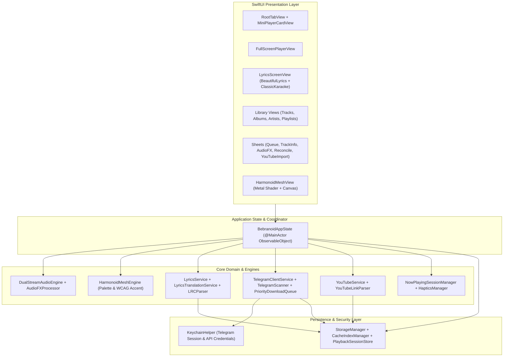

# Bebranoid iOS — Архитектура приложения (`ARCHITECTURE.md`)

Данный документ описывает архитектуру нативного iOS-порта **Bebranoid**, спроектированного для iPhone 15 Pro Max, iPhone 17 Pro Max и других современных моделей iPhone под управлением iOS 17.0+.

---

## 1. Обзор архитектурных принципов

1. **Полная автономность на устройстве**: Приложение не зависит от десктопного ПК или промежуточного домашнего сервера. Все подсистемы (Telegram-клиент, парсер метаданных, загрузчик с приоритетами, двухпоточный аудио-движок с DSP-эффектами, оба движка караоке-текстов, переводчик и генератор Mesh-фона) работают локально на iPhone.
2. **Честная 1:1 портируемость алгоритмов**: Все математические и доменные алгоритмы из Windows-версии (`HarmonoidMeshBackground`, `Spring`, `GetSpline`, `InterludeVisual`, `transformLyrics`, `romanizeLine`, `parseLrc`, `uiToGain`, `reshuffleUpcoming`, `playlistPreferences`, `splitArtists`, `parseMetaFromCaption`) перенесены на Swift с сохранением точных констант, формул и граничных условий.
3. **Нативный стек Apple**:
   - **UI**: `SwiftUI` + `Metal` (`HarmonoidMeshShader.metal`) + `CoreAnimation` / `TimelineView`.
   - **Аудио**: `AVFAudio` (`AVAudioEngine`, два `AVAudioPlayerNode` с индивидуальными цепочками эффектов `AVAudioUnitVarispeed` / `AVAudioUnitTimePitch`, `AVAudioUnitReverb`, `AVAudioUnitEQ`).
   - **Система**: `AVAudioSession`, `MPNowPlayingInfoCenter`, `MPRemoteCommandCenter`, `WidgetKit`, `ActivityKit` (Dynamic Island).
   - **Хранилище**: `SQLite3` / атомарные JSON-индексы в `Application Support/Bebranoid`, аудиокеш в `Documents/AudioCache`, сессия Telegram в `Keychain`.

---

## 2. Диаграмма компонентов



---

## 3. Структура каталогов `ios/`

```text
ios/
├── Package.swift                       # Swift Package манифест для сборки и запуска XCTest
├── project.yml                         # Спецификация XcodeGen для генерации .xcodeproj
├── Bebranoid.xcodeproj/
│   └── project.pbxproj                 # Готовый проект Xcode для macOS CI и локальной сборки
├── scripts/
│   └── verify-parity.mjs               # Автоматический кросс-тест математической идентичности JS <-> Swift
├── docs/
│   ├── FEATURE_PARITY.md               # Матрица функционального соответствия Windows <-> iOS
│   ├── ARCHITECTURE.md                 # Архитектурная документация
│   ├── SIDELOADING_GUIDE.md            # Инструкция по подписи и установке через AltStore / Sideloadly
│   └── BUILD_AND_TEST_REPORT.md        # Отчёт о проверке, тестах и CI пайплайне
├── Bebranoid/
│   ├── App/
│   │   ├── BebranoidApp.swift          # Точка входа SwiftUI App и жизненный цикл сцены
│   │   └── BebranoidAppState.swift     # Главный координатор состояния приложения
│   ├── Info.plist                      # Конфигурация бандла, UIBackgroundModes (audio, fetch)
│   ├── Bebranoid.entitlements          # App Groups и Keychain Access Groups
│   ├── Core/
│   │   ├── Track.swift                 # Модели трека, источников (Telegram, YouTube, Local)
│   │   ├── Album.swift                 # Модель альбома, включая виртуальный альбом «Любимые»
│   │   ├── Artist.swift                # Модель исполнителя
│   │   ├── Playlist.swift              # Модели пользовательских, YouTube и авто-плейлистов
│   │   ├── PlaybackState.swift         # Состояние плеера, режимы повтора, AudioFXMode, сортировки
│   │   ├── AudioFormatInfo.swift       # Технические метаданные и расчёт бейджей Hi-Res / Lossless / HQ
│   │   ├── AppConfig.swift             # Константы чатов AndroSend, лимиты, ключи хранилища
│   │   ├── VolumeCurve.swift           # Перцептивная кривая громкости u^2.75
│   │   ├── QueueOrder.swift            # Алгоритм reshuffleUpcoming с защитой от повторов
│   │   ├── PlaylistPreferences.swift   # Лимиты шаффла YouTube-плейлистов и reconcilePlaylist
│   │   └── ArtistSplitter.swift        # Разделение коллабораций и выбор канонического имени
│   ├── Storage/
│   │   ├── KeychainHelper.swift        # Безопасное хранение сессии Telegram и ключей в Keychain
│   │   ├── StorageManager.swift        # Управление файловой системой, обложками, импортом файлов
│   │   ├── CacheIndexManager.swift     # Индекс аудиокеша, расчёт сверки по альбомам, очистка
│   │   └── PlaybackSessionStore.swift  # Персистентность очереди, настроек, скрытых альбомов, счётчиков
│   ├── MeshBackground/
│   │   ├── HarmonoidMeshEngine.swift   # 40x40 квантование палитры, HSV-слоты, WCAG-акцент, траектории
│   │   ├── HarmonoidMeshShader.metal   # Metal-шейдер 4 радиальных пятен с виньеткой и 12% затемнением
│   │   └── HarmonoidMeshView.swift     # SwiftUI компонент с плавной интерполяцией и синхронизацией с кроссфейдом
│   ├── AudioEngine/
│   │   ├── SmoothClock.swift           # 60/120Hz интерполятор времени для плавных слайдеров и караоке
│   │   ├── AudioMetadataReader.swift   # Чтение FLAC/WAV/M4A/MP3 заголовков и AVAsset метаданных
│   │   ├── AudioFXProcessor.swift      # Граф DSP эффектов (Slowed, Speedup, Reverb, Bass Boost +8dB)
│   │   └── DualStreamAudioEngine.swift # Двухдековый AVAudioEngine с реальным перекрывающимся кроссфейдом
│   ├── Telegram/
│   │   ├── TelegramClientService.swift # Автономный клиент Telegram (Auth, чаты, топики, скачивание)
│   │   ├── TelegramScanner.swift       # Парсер AndroSend подписей, разрешение альбомов, 3x дедупликация архива
│   │   ├── PriorityDownloadQueue.swift # Очередь загрузок с приоритетами (3/1/0) и вытеснением DownloadPreempted
│   │   └── TelegramAuthViewModel.swift # ViewModel пошаговой авторизации (телефон -> код -> 2FA)
│   ├── YouTube/
│   │   ├── YouTubeLinkParser.swift     # Парсинг URL видео, плейлистов, Shorts и YouTube Music
│   │   ├── YouTubeService.swift        # Извлечение плейлистов/треков через Innertube и загрузка m4a потока
│   │   └── YouTubeImportSheet.swift    # UI импорта и синхронизации YouTube-плейлистов
│   ├── Lyrics/
│   │   ├── LRCParser.swift             # Парсер LRC и Enhanced Word-Synced LRC
│   │   ├── Spring.swift                # Аналитический пружинный солвер (critically/under/over-damped)
│   │   ├── CubicSpline.swift           # Натуральный кубический сплайн1D
│   │   ├── InterludeEngine.swift       # Физика 3 точек проигрыша («marble roll» волна)
│   │   ├── Romanizer.swift             # Романизация JP (Kana/Kanji), KR (Hangul), CN (Hanzi)
│   │   ├── BeautifulLyricsTransform.swift # Группировка слогов, выделение бэк-вокала и пауз Interlude
│   │   ├── LyricsService.swift         # Поиск текста: кеш -> теги -> LRCLIB со скорингом
│   │   ├── LyricsTranslationService.swift # Перевод через Google GTX + Amalgama-Lab + синхронизация
│   │   ├── BeautifulLyricsView.swift   # Послоговый пружинный рендерер с посимвольным Emphasized режимом
│   │   └── ClassicKaraokeLyricsView.swift # Классический градиентный караоке-рендерер
│   ├── SystemIntegration/
│   │   ├── NowPlayingSessionManager.swift # MPNowPlayingInfoCenter, MPRemoteCommandCenter, AVAudioSession
│   │   ├── HapticsManager.swift        # Тактильная отдача iPhone
│   │   └── BackgroundDownloadManager.swift # Фоновые загрузки URLSession и управление задачами
│   ├── Views/
│   │   ├── RootTabView.swift           # Корневая навигация, нижний мини-плеер и модальные экраны
│   │   ├── MiniPlayerCardView.swift    # Плавающий мини-плеер над таб-баром
│   │   ├── FullScreenPlayerView.swift  # Полноэкранный плеер по референсному макету
│   │   ├── LyricsScreenView.swift      # Полноэкранный экран текстов по референсному макету
│   │   ├── TracksListView.swift        # Экран треков, фильтры, сортировка и модальное окно «Сверка»
│   │   ├── AlbumsGridView.swift        # Сетка альбомов, «Любимые», скрытые и исключённые из шаффла
│   │   ├── AlbumDetailView.swift       # Экран альбома с перетаскиванием треков и сменой обложки
│   │   ├── ArtistsGridView.swift       # Сетка исполнителей с закреплёнными избранными
│   │   ├── ArtistDetailView.swift      # Экран исполнителя (все треки и альбомы)
│   │   ├── PlaylistsGridView.swift     # Сетка плейлистов («Последние 30», пользовательские, YouTube)
│   │   ├── PlaylistDetailView.swift    # Экран плейлиста с настройками лимита шаффла (±10) и сверкой
│   │   ├── QueueSheetView.swift        # Управление очередью воспроизведения (drag-to-reorder, очистка)
│   │   ├── TrackInfoSheetView.swift    # Техническая карточка трека (кодек, битрейт, путь, ID)
│   │   ├── AudioFXSheetView.swift      # Панель эффектов (Slowed, Reverb, Speedup, Bass Boost, Crossfade)
│   │   ├── SettingsView.swift          # Полный экран настроек приложения
│   │   └── TelegramAuthView.swift      # Экран входа в Telegram
│   └── Widgets/
│       ├── BebranoidWidgetBundle.swift # Точка входа расширения виджетов
│       ├── NowPlayingWidget.swift      # Виджет текущего трека для Home Screen и Lock Screen
│       └── PlaybackLiveActivity.swift  # Конфигурация Dynamic Island (iPhone 15/17 Pro Max)
└── Tests/
    └── BebranoidTests/
        ├── MeshPaletteTests.swift
        ├── LRCParserTests.swift
        ├── BeautifulLyricsTransformTests.swift
        ├── QueueOrderTests.swift
        ├── PlaylistPreferencesTests.swift
        ├── VolumeCurveTests.swift
        ├── TelegramParserTests.swift
        └── YouTubeLinkParserTests.swift
```

---

## 4. Детали ключевых подсистем

### 4.1. Двухпоточный аудио-движок (`DualStreamAudioEngine`)
В отличие от простого `AVPlayer`, в Bebranoid используется полноценный граф `AVAudioEngine` с двумя независимыми ветвями (`Deck A` и `Deck B`), сходящимися в `mainMixerNode`:

```text
[Deck A: AVAudioPlayerNode] -> [Varispeed / TimePitch A] -> [EQ BassBoost A] -> [Reverb Wet/Dry Mixer A] -> [Deck Gain A] ──┐
                                                                                                                            ├──> [MainMixerNode] -> [OutputNode]
[Deck B: AVAudioPlayerNode] -> [Varispeed / TimePitch B] -> [EQ BassBoost B] -> [Reverb Wet/Dry Mixer B] -> [Deck Gain B] ──┘
```

- **Натуральный питч-шифт для FX**: Когда активен режим `slowed`, `slowed_reverb`, `speedup` или `speedup_reverb`, активируется узел `AVAudioUnitVarispeed`, который изменяет скорость вместе с высотой тона (аналогично `preservesPitch = false` в Electron). Когда выбран режим `normal`, скорость регулируется через `AVAudioUnitTimePitch` без изменения высоты тона.
- **Реверберация и фильтрация**: В режимах `slowed_reverb` и `speedup_reverb` включается каскад реверберации (с параметрами, соответствующими 2.8-секундному стерео импульсу с экспоненциальным затуханием) и НЧ-фильтром среза высоких частот на `6500 Hz` (`lowPass`), обеспечивая фирменное тёплое атмосферное звучание.
- **Bass Boost**: Узел `AVAudioUnitEQ` с параметрической полосой `lowShelf` на частоте `180 Hz`, усилением `+8.0 dB` и добротностью `Q = 0.707`.
- **Кроссфейд**: При приближении к концу трека (`duration - currentTime <= crossfadeDuration`) свободный дек (`Deck B`) загружает следующий трек очереди и стартует с `gain = 0`. Таймер `SmoothClock` (60 Гц) плавно интерполирует громкость обоих деков с учётом кривой `uiToGain(volume)` и одновременно передаёт `crossfadeProgress (0...1)` в `HarmonoidMeshEngine` для синхронного перетекания фона.

### 4.2. Математический конвейер `HarmonoidMeshEngine`
1. **Downscale 40x40**: Обложка рендерится в буфер `40x40` RGBA (`1600` пикселей).
2. **Фильтрация и квантование**: Отбрасываются пиксели с `alpha < 128`, `max(r,g,b) < 18` или `min(r,g,b) > 244`. Оставшиеся группируются по ключу `floor(r/24)*24 | floor(g/24)*24 | floor(b/24)*24`.
3. **Скоринг и нормализация**: Каждый бакет получает вес `count * (1 + sat * 1.15) * (val in 0.15...0.92 ? 1.1 : 0.7)`. Выбираются 4 цвета на евклидовом расстоянии `>= 85`, сортируются по `sat * 0.7 + val * 0.3` и приводятся к целевым диапазонам HSV для 4 слотов (`Deep Shadow`, `Rich Primary`, `Secondary Vivid`, `Highlight`).
4. **Рендеринг и анимация**: 4 радиальных градиента радиусом `0.78 * max(width, height)` смешиваются в режиме `plusLighter` (аддитивное свечение), затемняются на `12%` и покрываются вертикальной виньеткой (`0.22` сверху, `0.06` в центре, `0.28` снизу).

### 4.3. Приоритетная очередь загрузок (`PriorityDownloadQueue`)
- Каждая задача имеет приоритет: `3` (воспроизводимый прямо сейчас трек), `1` (следующий трек в очереди — prefetch), `0` (фоновое скачивание альбома или пакетная докачка из окна «Сверка»).
- При постановке задачи с приоритетом `3` все существующие задачи с приоритетом `3` понижаются до `1`, а выполняющиеся фоновые задачи с приоритетом `< 3` получают сигнал кооперативного вытеснения `DownloadPreempted`, сохраняют уже скачанные байты во временный `.part` файл и возвращаются в очередь ожидания.
